# Advanced Lane Finding


Lane detection for a car's front camera, built with classical computer vision in Python and OpenCV, with no neural networks.
For every frame the pipeline finds the lane the car is driving in, marks it on the road, and measures two things:
the **radius of the curve** and the **position of the car** inside its lane, both in meters.

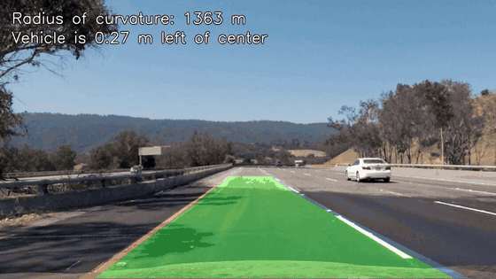

## Highlights

* **One pipeline, three cameras.** The data comes from three different cameras. Each has its own profile with its own
  calibration and perspective points, chosen automatically from the file name and image size.
* **Robust lane mask.** Colour and gradient thresholds are combined with a morphological top-hat filter. The filter keeps
  only narrow bright stripes, so shadow borders, tar seams and concrete patches are ignored.
* **Video tracking.** In a video the pipeline searches near the lane from the previous frame, checks every new result
  (lane width, parallel lines, no sudden jumps), averages the last 8 good results and recovers on its own after bad frames.
* **Results.** The lane is found on all 17 test images and in every frame of 4 of the 6 videos.
* **Every step is visible.** For each test image, all six intermediate steps are saved as images, and the videos can be
  rendered with a debug view underneath.

## Contents

* [Results](#results)
* [How it works](#how-it-works)
* [Project structure](#project-structure)
* [How to run](#how-to-run)
* [The data: three different cameras](#the-data-three-different-cameras)
* [1. Camera calibration](#1-camera-calibration)
* [2. Distortion correction](#2-distortion-correction)
* [3. Thresholded binary image](#3-thresholded-binary-image)
* [4. Perspective transform](#4-perspective-transform)
* [5. Finding the lane lines](#5-finding-the-lane-lines)
* [6. Curvature and vehicle position](#6-curvature-and-vehicle-position)
* [7. Drawing the lane back onto the road](#7-drawing-the-lane-back-onto-the-road)
* [8. Video](#8-video)
* [Limitations and possible improvements](#limitations-and-possible-improvements)
* [References and acknowledgements](#references-and-acknowledgements)

## Results

| | | |
|---|---|---|
| 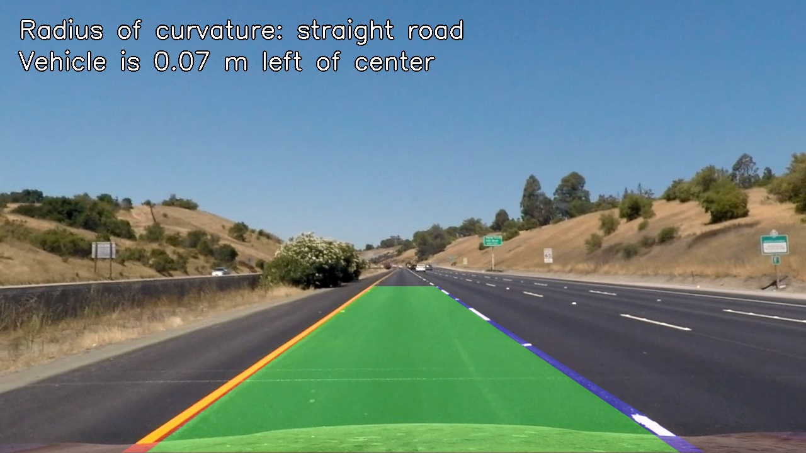 | 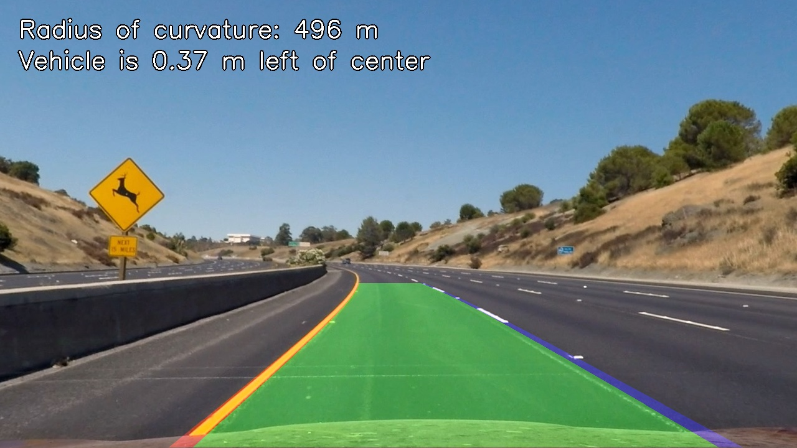 | 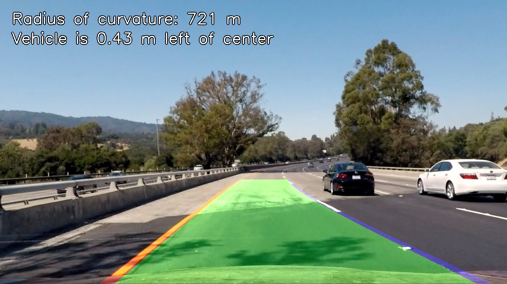 |
| straight road | curve, 496 m | bright concrete and shadows |
| 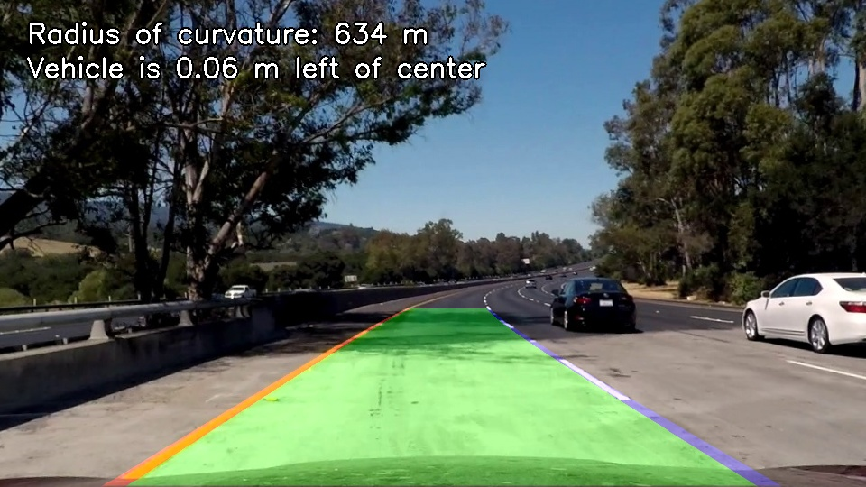 | 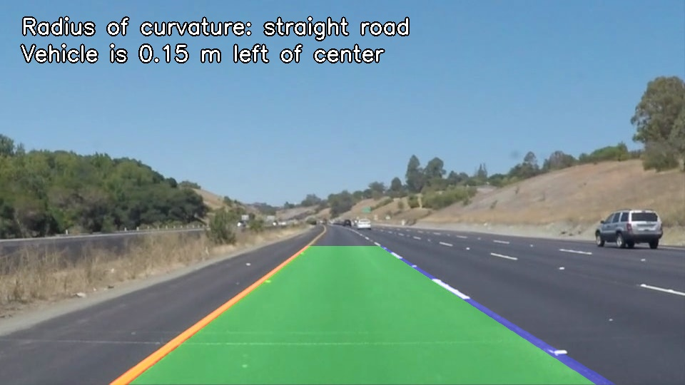 | 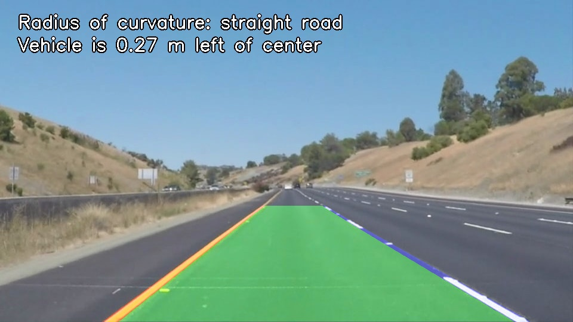 |
| shadows on a bridge | second camera (960x540) | second camera, dashed lines |

| Video | Camera | Length | Frames | Frames with a new valid fit | Output |
|---|---|---:|---:|---:|---|
| project_video01 | p1 | 8.8 s | 221 | 221 (100 %) | [project_video01_out.mp4](output_videos/project_video01_out.mp4) |
| project_video02 | p1 | 27.2 s | 681 | 681 (100 %) | [project_video02_out.mp4](output_videos/project_video02_out.mp4) |
| project_video03 | main | 50.4 s | 1260 | 1260 (100 %) | [project_video03_out.mp4](output_videos/project_video03_out.mp4) |
| challenge01 | main | 10.0 s | 251 | 251 (100 %) | [challenge01_out.mp4](output_videos/challenge01_out.mp4) |
| challenge02 | c2 | 16.1 s | 484 | 418 (86 %) | [challenge02_out.mp4](output_videos/challenge02_out.mp4) |
| challenge03 | main | 48.0 s | 1199 | 484 (40 %) | [challenge03_out.mp4](output_videos/challenge03_out.mp4) |

In frames without a new valid fit, the last good lane stays on screen. challenge03 is a mountain road with very sharp
curves and strong light changes. Where it fails, and why, is shown in
[Limitations and possible improvements](#limitations-and-possible-improvements).

## How it works

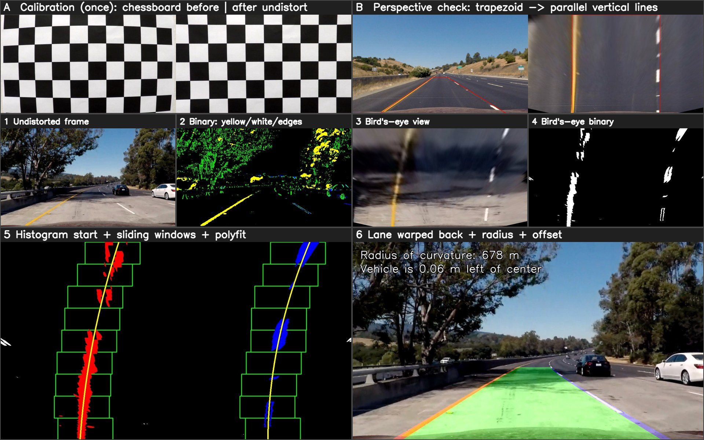

```
calibration (once)
      |
frame -> undistort -> binary mask -> bird's-eye view -> histogram + sliding windows -> 2nd order polynomials
      -> radius + offset in meters -> lane drawn in the bird's-eye view -> warped back -> blended with the frame
```

| Step | What happens | Code |
|---|---|---|
| A | Camera calibration from 20 chessboard photos (once) | [`src/calibration.py`](src/calibration.py) |
| B | Perspective points measured on a straight road (once per camera) | [`src/config.py`](src/config.py) |
| 1 | Lens distortion removed | [`src/calibration.py`](src/calibration.py) |
| 2 | Binary mask of the lane paint: yellow, white and gradient | [`src/thresholds.py`](src/thresholds.py) |
| 3-4 | Image and mask warped to a bird's-eye view, where the lane lines are parallel | [`src/perspective.py`](src/perspective.py) |
| 5 | Starting points from a histogram, line pixels collected with sliding windows, polynomial fit | [`src/lane_detection.py`](src/lane_detection.py) |
| 6 | Radius of curvature and vehicle offset converted to meters; lane drawn and warped back | [`src/lane_detection.py`](src/lane_detection.py), [`src/pipeline.py`](src/pipeline.py) |

## Project structure

| File / folder | Content |
|---|---|
| [`src/config.py`](src/config.py) | folders, chessboard size, camera profiles (perspective points, meters per pixel) |
| [`src/calibration.py`](src/calibration.py) | camera calibration and undistortion |
| [`src/thresholds.py`](src/thresholds.py) | colour and gradient thresholds, binary image |
| [`src/perspective.py`](src/perspective.py) | transform to the bird's-eye view and back |
| [`src/lane_detection.py`](src/lane_detection.py) | histogram, sliding windows, polynomial fit, curvature, vehicle offset |
| [`src/pipeline.py`](src/pipeline.py) | the whole pipeline for one frame, checks and smoothing between frames, drawing |
| [`src/run_images.py`](src/run_images.py) | runs the pipeline on `test_images/` and saves every step |
| [`src/run_video.py`](src/run_video.py) | runs the pipeline on videos |
| `camera_cal/` | chessboard photos and the calibration result `calib.npz` |
| `test_images/`, `test_videos/` | input data |
| `output_images/` | results: `<image>/1_undistorted.jpg` ... `6_result.jpg` for every test image |
| `output_videos/` | processed videos (stored with Git LFS) |
| `docs/` | figures used in this README |

## How to run

```powershell
git clone https://github.com/Jobah3/lane-finding.git
cd lane-finding

py -3.12 -m venv .venv
.\.venv\Scripts\Activate.ps1          # Linux / macOS: source .venv/bin/activate
pip install -r requirements.txt

python src/calibration.py                                  # once: creates camera_cal/calib.npz
python src/run_images.py                                   # all test images -> output_images/
python src/run_video.py test_videos/project_video03.mp4   # one video -> output_videos/
python src/run_video.py --all                              # all six videos
```

| Option of `run_video.py` | Effect |
|---|---|
| `--show` | shows the frames live (Esc stops, Space pauses) |
| `--debug` | adds the binary mask and the bird's-eye detection under every frame |
| `--all` | processes every video in `test_videos/` |

After each video, `run_video.py` prints how many frames got a new valid fit, kept the previous lane, or were reset.
Processing runs at about 8-9 frames per second on a laptop CPU.

Tested with Python 3.12, OpenCV (contrib) 4.12.0, NumPy 2.2.6 and Matplotlib 3.11.

## The data: three different cameras

The images and videos were recorded with three different cameras. A single set of parameters cannot work for all of them,
because the perspective points and the meters-per-pixel values depend on where the camera is mounted and how it is aimed.
Calibration photos exist for only one of the cameras. Every image or video is therefore matched to a **camera profile**
(`PROFILES`, `pick_profile()` and `Profile` in [`src/config.py`](src/config.py)). A profile holds the image size, whether
the camera is calibrated, the perspective points and the meters per pixel. All values are scaled automatically to the actual
image size.

| Profile | Size | Calibration | Used for |
|---|---|---|---|
| `main` | 1280x720 | yes (`camera_cal/`) | test1-6, straight_lines1-2, challange00101/111/136, project_video03, challenge01, challenge03 |
| `p1` | 960x540 | no | solid\*, whiteCarLaneSwitch, project_video01, project_video02 |
| `c2` | 1280x720 | no | challenge02: a different camera position (horizon at y ≈ 455, car hood visible from y ≈ 685) |

The three `challange*` images are frames of challenge01 scaled down to 960x540. They belong to the calibrated camera, so its
camera matrix is scaled by the same factor of 0.75 (f<sub>x</sub>, f<sub>y</sub>, c<sub>x</sub>, c<sub>y</sub>). The
distortion coefficients do not depend on the image size and stay the same (`scale_camera_matrix()` in
[`src/calibration.py`](src/calibration.py)).

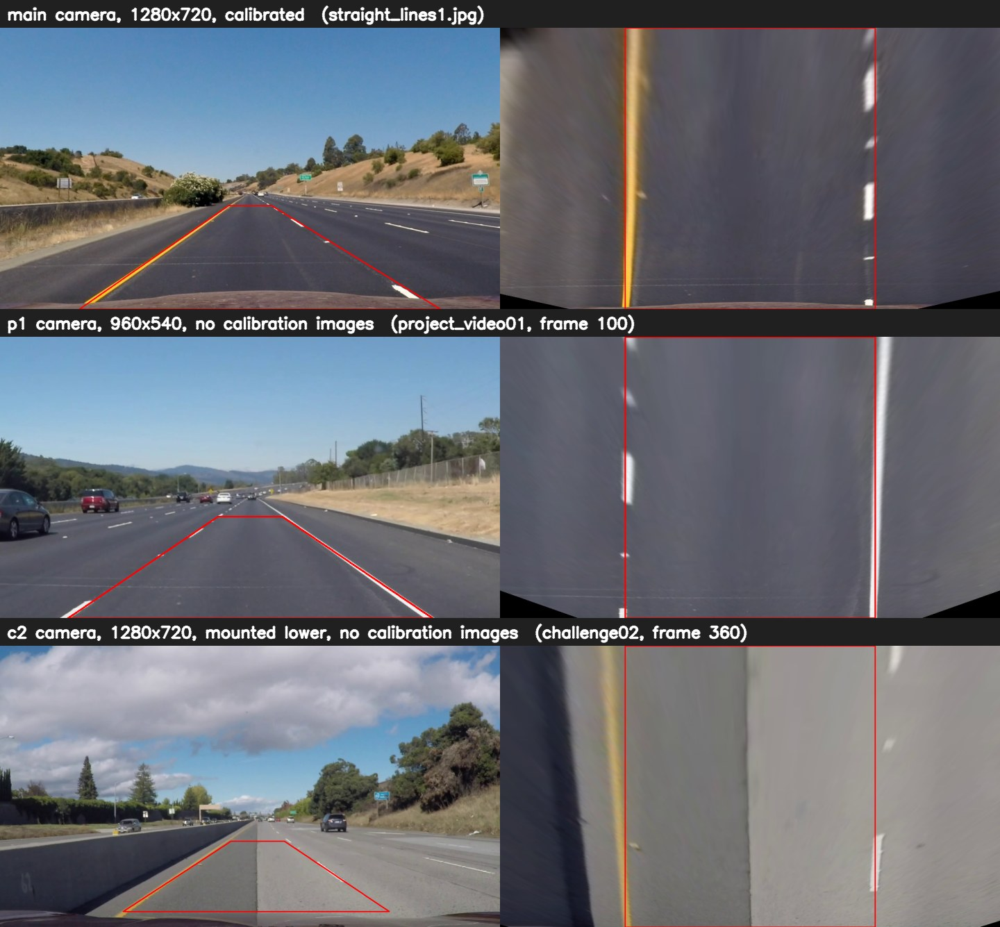

---

## 1. Camera calibration

**Code:** [`src/calibration.py`](src/calibration.py) - `calibrate()`, `load_calibration()`, `undistort()`

A camera lens bends straight lines, most visibly near the edges of the image. Calibration measures this distortion so it can be
removed. A chessboard is used because its corners lie on a flat surface at exactly known positions.

1. For every photo in `camera_cal/`, `cv.findChessboardCorners` looks for the 9x6 inner corners. `cv.cornerSubPix` then
   refines them to sub-pixel accuracy (11x11 search window, at most 30 iterations or until the change is below 0.001 px).
   These are the **image points**.
2. The **object points** are the same corners in the chessboard's own coordinate system: (0,0,0), (1,0,0) ... (8,5,0).
   The board is flat, so z = 0 for every corner.
3. `cv.calibrateCamera` finds the camera matrix and the distortion coefficients that best map the object points onto the
   image points in all photos. The image size is set to 1280x720 explicitly, because two of the photos are 1281x721.
4. The result is saved to `camera_cal/calib.npz` and loaded by all other scripts.

The board was found in 17 of the 20 photos. In `calibration1.jpg`, `calibration4.jpg` and `calibration5.jpg` part of the board
is outside the frame, so not all 54 corners are visible. Using two of these three with a smaller pattern (9x5 and 7x6) was
also tested. The RMS error only dropped from 1.003 to 0.996 px, vehicle offsets changed by less than 1 cm and radii by up to
6 %, so the simpler version was kept.

| | Value |
|---|---|
| Photos used | 17 of 20 |
| RMS re-projection error | 1.003 px |
| f<sub>x</sub>, f<sub>y</sub> (focal length) | 1156.5 px, 1151.3 px |
| c<sub>x</sub>, c<sub>y</sub> (optical centre) | 671.3 px, 389.2 px |
| k<sub>1</sub>, k<sub>2</sub>, p<sub>1</sub>, p<sub>2</sub>, k<sub>3</sub> | -0.2467, -0.0254, -0.0007, 0.0001, 0.0107 |

* The **RMS error** means that the corners projected through the camera model land about 1 px from the detected corners.
  For photos of a paper chessboard saved as JPEG, that is a normal value.
* The "mean error" printed by the script uses the formula that divides the error of each photo
  by the number of corners without taking a square root per corner, so it comes out about 7 times smaller (√54 ≈ 7.3).
* **k<sub>1</sub> < 0** means barrel distortion: straight lines bulge outward toward the edges of the image.


`calibration1.jpg` was not used for the calibration because its corners could not all be found, yet it is corrected
properly. That makes it a fair check of the camera model on a photo it has never seen:

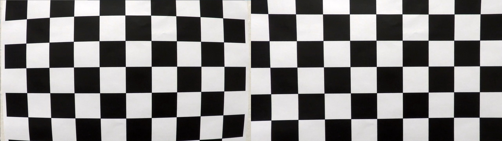

## 2. Distortion correction

**Code:** `undistort()` in [`src/calibration.py`](src/calibration.py), called from `LaneFinder.process()` in [`src/pipeline.py`](src/pipeline.py)

Every frame from the `main` camera is corrected with `cv.undistort`, using the saved camera matrix and distortion
coefficients. The same camera matrix is used as the output matrix. `cv.getOptimalNewCameraMatrix(alpha=1)` was avoided on
purpose: it would change the focal length from 1156 to 982 px and move the perspective points of the next step by up to
85 px. The other two cameras have no calibration photos, so their frames are used as they are.

The difference is easiest to see at the edges of the image and on the car hood at the bottom:

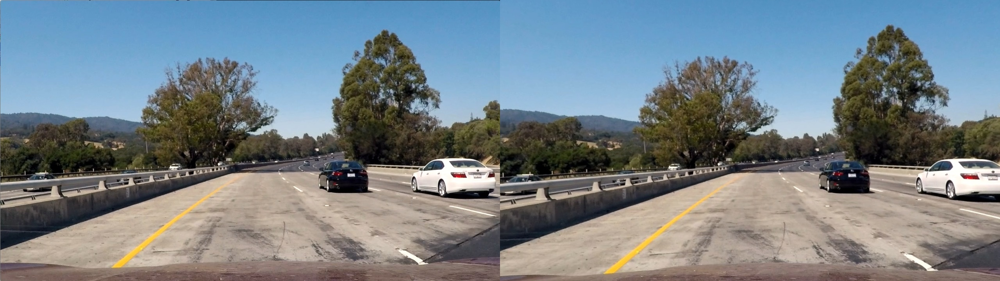

## 3. Thresholded binary image

**Code:** [`src/thresholds.py`](src/thresholds.py) - `combined_binary()`, `yellow_mask()`, `white_mask()`, `ridge()`, `sobel_x_mask()`

The mask is built on one observation: a lane marking is a **narrow stripe that is brighter than the road next to it**.
After a 5x5 Gaussian blur, three masks are computed and combined with OR:

| Mask | Rule | Why |
|---|---|---|
| yellow paint | HSV hue 17-35, S ≥ 75, V ≥ 60 **and** LAB B ≥ 142 | Yellow paint has a hue of about 18-25. Brown dirt next to the road has 12-19 and was picked up by the LAB B channel alone. |
| white paint | HLS L ≥ max(170, 96th percentile of the lower half), S < 120, top-hat > 20 | The limit follows the brightness of the road, so it works on dark asphalt and on bright concrete. |
| edges | Sobel in x on the L channel (3x3), absolute value scaled to 0-255, ≥ 30, kept only where top-hat ≥ 25 | Lane lines are close to vertical, so the x gradient is strong on them. |

The **top-hat** filter (`L - opening(L)` with a 41x1 kernel, scaled with the image width) measures how much a pixel is
brighter than the road to its left and right. A wide bright area or a step from dark to bright gives almost nothing, while
a stripe narrower than the kernel gives a strong response.

| Masks: yellow = yellow paint, blue = white paint, green = Sobel edges | Final mask in the bird's-eye view |
|---|---|
| 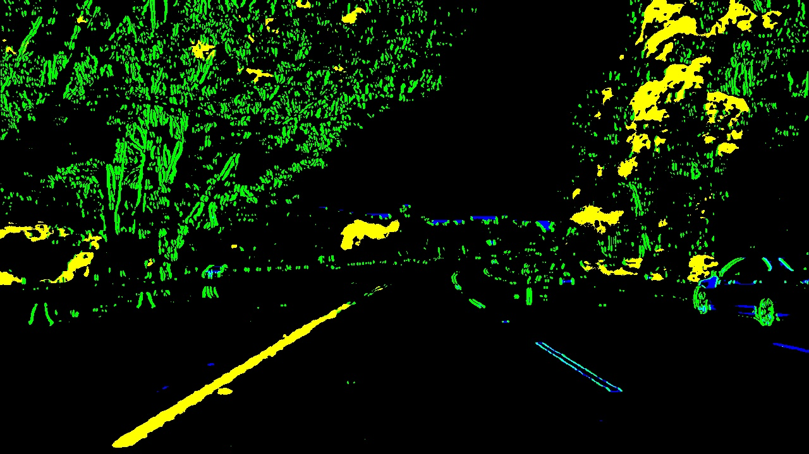 | 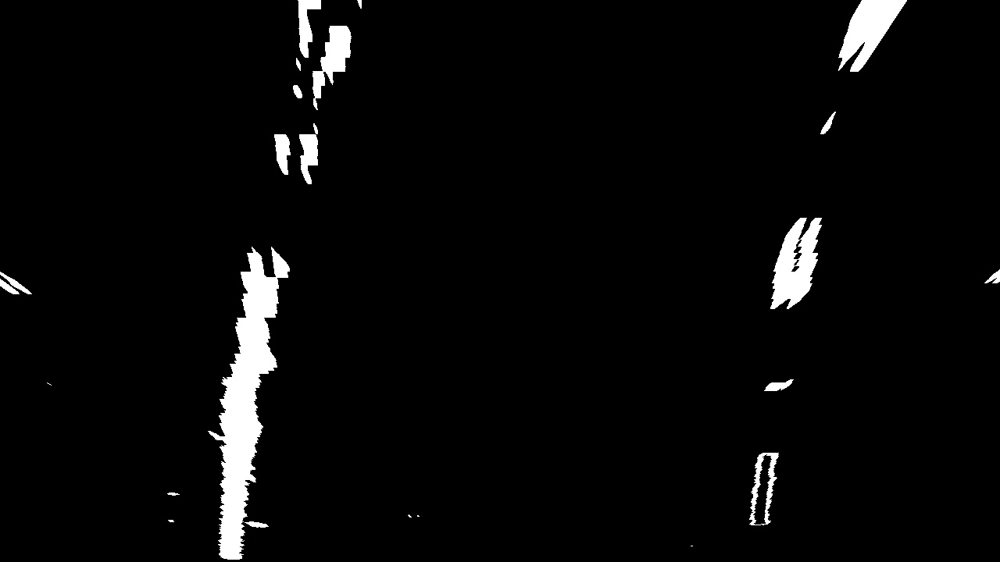 |

The trees and the sky are also full of detections, but that does not matter: only the road area inside the trapezoid of the
next step is used.

**Why the top-hat filter is needed.** Sobel alone also reacts to every border between light and shade, here the edge of the
barrier's shadow on the bright concrete. With the top-hat condition that edge disappears, while the lane markings stay.
The yellow line itself is found by the colour mask.

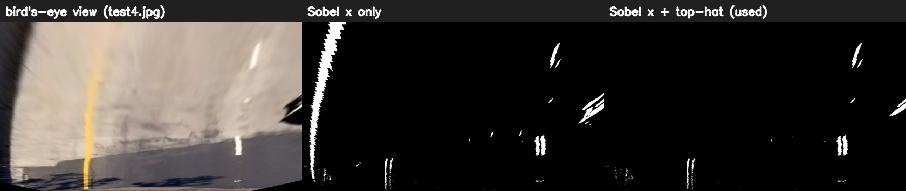

**Why the hue rule is needed.** On the mountain road of challenge03, the LAB B channel alone also selects the brown dirt on
the right shoulder, which lies exactly where the right line is searched for. Adding the hue range removes the dirt and keeps
the double yellow line:

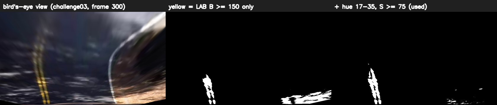

## 4. Perspective transform

**Code:** [`src/perspective.py`](src/perspective.py) - `Perspective` (`warp()`, `unwarp()`, `warp_point()`); points in `PROFILES` in [`src/config.py`](src/config.py)

In the camera view the two lane lines meet near the horizon, and the curvature is hard to measure. A perspective transform
maps a trapezoid lying on the road onto a rectangle, giving a view from above: the lane lines become parallel, and distances
in pixels correspond to distances on the road.

* The **source points** (`src`) were picked on `straight_lines1.jpg`, a straight road, directly on the two lane lines.
* The **destination points** (`dst`) form a rectangle 640 px wide, centred in the image.
* `cv.getPerspectiveTransform(src, dst)` gives the matrix **M**, and `cv.warpPerspective` applies it.
* The inverse matrix **Minv** (`dst` -> `src`) is used at the end to draw the lane back onto the original image.

| Point | src (x, y) | dst (x, y) |
|---|---|---|
| top left | 585, 455 | 320, 0 |
| bottom left | 203, 720 | 320, 720 |
| bottom right | 1127, 720 | 960, 720 |
| top right | 695, 455 | 960, 0 |

The check: on a straight road, both lines must come out vertical and parallel. The points of the `p1` and `c2` cameras were
found the same way, on straight sections of project_video01 and challenge02.

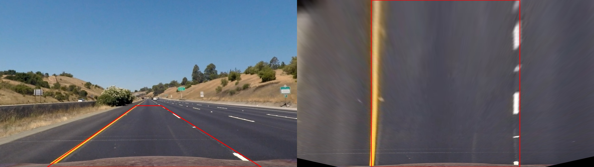

## 5. Finding the lane lines

**Code:** [`src/lane_detection.py`](src/lane_detection.py) - `histogram_bases()`, `sliding_windows()`, `search_around_poly()`, `fit_poly()`

1. **Histogram.** The white pixels of the lower half of the bird's-eye mask are counted in every column. The lines are
   almost vertical there, so they show up as two peaks. The histogram is smoothed over 25 px so that a dashed line or a
   double line gives a single peak. Only the range of ±0.85 lane widths around the image centre is searched, which ignores
   barriers and the neighbouring lanes.

   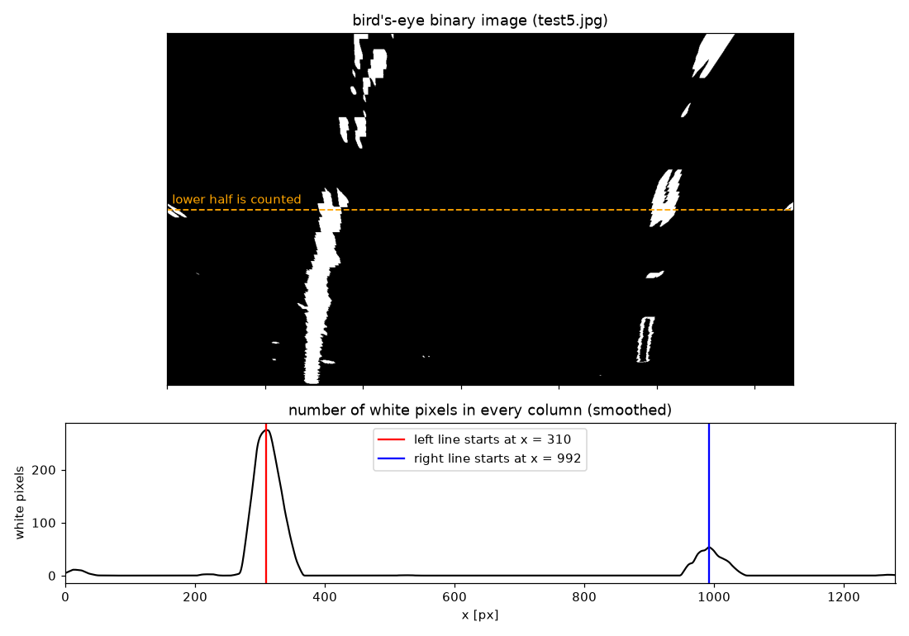

2. **Sliding windows.** Starting from the two peaks, 9 windows per line (200 px wide) climb from the bottom to the top and
   collect the white pixels inside them. When a window finds more than 50 pixels, the next one is centred on their mean x.
   When it finds fewer, for example in the gap of a dashed line, it continues in the direction of the last step, so it keeps
   following the curve.
3. **Polynomial.** A second order polynomial is fitted to the pixels of each line with `np.polyfit`:

   $$x = A y^2 + B y + C$$

   x is written as a function of y because the lines are nearly vertical: every row has exactly one x, while the opposite
   would not work for a vertical line. A fit needs at least 200 pixels that cover at least 60 px of height.
4. **Video.** From the second frame on, the windows are skipped and pixels are taken only within ±80 px of the polynomials
   from the previous frame (`search_around_poly()`), which is faster and more stable.

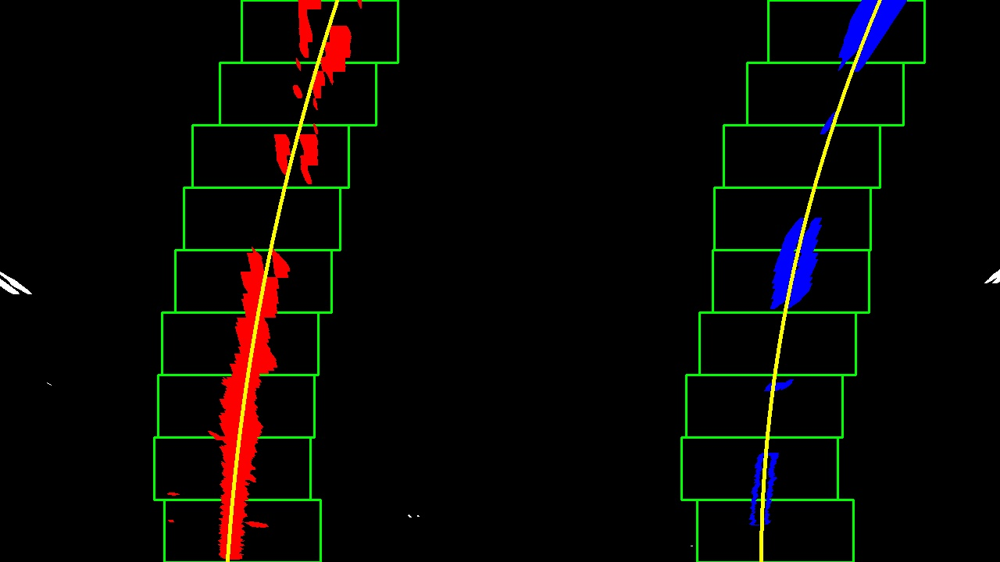

Example, `test5.jpg` (in pixels, y = 0 at the top):

| Line | A | B | C | Pixels |
|---|---:|---:|---:|---:|
| left | 1.80·10⁻⁴ | -0.325 | 432.0 | 21 276 |
| right | 2.88·10⁻⁴ | -0.418 | 1126.3 | 10 176 |

C is the x position of the line at the top of the image, B its slope there, and A how strongly it bends. Both A values are
positive and of similar size, so both lines bend to the same side, as they should in a curve.

## 6. Curvature and vehicle position

**Code:** [`src/lane_detection.py`](src/lane_detection.py) - `curvature_m()`, `vehicle_offset_m()`; scale values in [`src/config.py`](src/config.py)

**Pixels to meters.** In the bird's-eye view the lane is 640 px wide, and a highway lane is 3.7 m wide, which gives
x<sub>m</sub> = 3.7 / 640 m per pixel across the road. Along the road, the dashed lines are used as a ruler: one dash plus
one gap is 12 m on US highways. On `straight_lines1.jpg` that is about 303 px, so 720 px cover about 28.5 m. The usual
value of 30 m per 720 px was kept.

| Profile | x<sub>m</sub> (across the road) | y<sub>m</sub> (along the road) |
|---|---|---|
| `main` | 3.7 m / 640 px | 30 m / 720 px |
| `p1` | 3.7 m / 480 px | 27 m / 540 px |
| `c2` | 3.7 m / 640 px | 36 m / 720 px |

**Radius of curvature.** The polynomial coefficients are converted to meters, and the radius is evaluated at the bottom of
the image, the part of the road closest to the car:

$$A_m = A \cdot \frac{x_m}{y_m^2} \qquad B_m = B \cdot \frac{x_m}{y_m} \qquad R = \frac{\left(1 + (2A_m y + B_m)^2\right)^{3/2}}{\left|2A_m\right|}$$

The radius of the lane is the mean of the left and right radius. On a straight road A is almost 0, and because R depends on
1/A, small noise changes the value a lot. That is why every radius above 3000 m is displayed as "straight road".

**Vehicle position.** The camera is assumed to be mounted in the middle of the car. Its position in the bird's-eye view is
found by warping the bottom centre of the image with the same matrix M. The offset is the distance between that point and
the middle of the two lines at the bottom of the image, multiplied by x<sub>m</sub>. A negative value means the car is left
of the lane centre.

Results on all test images (`python src/run_images.py`):

| Image | Camera | Radius [m] | Offset [m] | Shown on the image |
|---|---|---:|---:|---|
| straight_lines1 | main | 13 702 | -0.07 | straight road |
| straight_lines2 | main | 6 446 | -0.08 | straight road |
| test1 | main | 714 | -0.26 | 714 m |
| test2 | main | 496 | -0.37 | 496 m |
| test3 | main | 713 | -0.20 | 713 m |
| test4 | main | 721 | -0.43 | 721 m |
| test5 | main | 678 | -0.06 | 678 m |
| test6 | main | 2 180 | -0.30 | 2180 m |
| challange00101 | main | 765 | -0.30 | 765 m |
| challange00111 | main | 906 | -0.26 | 906 m |
| challange00136 | main | 634 | -0.06 | 634 m |
| solidWhiteCurve | p1 | 5 651 | -0.33 | straight road |
| solidWhiteRight | p1 | 3 318 | -0.07 | straight road |
| solidYellowCurve | p1 | 5 754 | -0.15 | straight road |
| solidYellowCurve2 | p1 | 13 254 | -0.18 | straight road |
| solidYellowLeft | p1 | 2 227 | -0.11 | 2227 m |
| whiteCarLaneSwitch | p1 | 3 526 | -0.27 | straight road |

The curves come out at 500-900 m, a realistic range for highway curves, and the straight roads at several kilometres.
`solidWhiteCurve` and `solidYellowCurve` are reported as straight because the radius is measured right in front of the car,
and in those photos the road only starts to bend further ahead.

## 7. Drawing the lane back onto the road

**Code:** `LaneFinder._draw_lane()` and `LaneFinder._write_text()` in [`src/pipeline.py`](src/pipeline.py)

1. On an empty image in the bird's-eye view, the area between the two polynomials is filled with green (`cv.fillPoly`),
   and the left and right line are drawn in red and blue.
2. This image is warped back to the camera view with the inverse matrix **Minv**.
3. It is blended over the undistorted frame with 35 % opacity (`cv.addWeighted`), so the road stays visible.
4. The radius and the vehicle position are written in the top left corner.

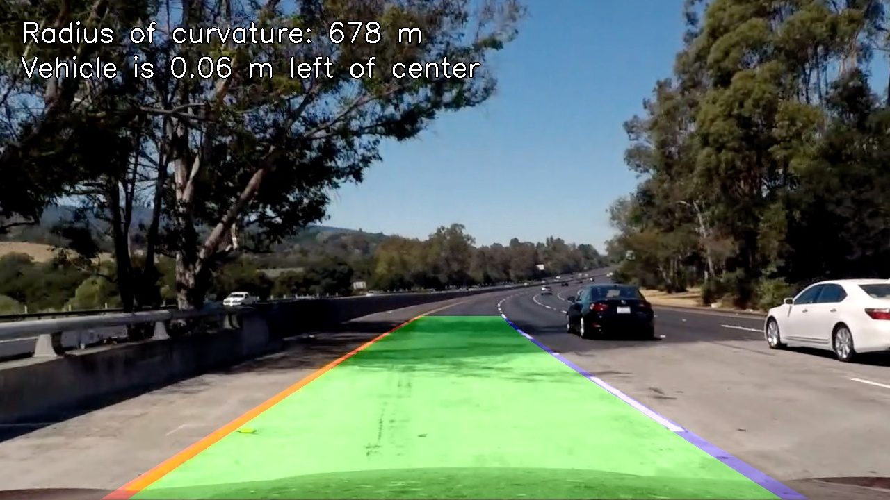

---

## 8. Video

**Code:** `LaneFinder.process()` and `Line` in [`src/pipeline.py`](src/pipeline.py), [`src/run_video.py`](src/run_video.py)

Each frame goes through the same steps as a single image, but the pipeline also uses what it learned from the previous frames:

1. **Search near the last lane.** If a lane is known, pixels are only taken within ±80 px of it.
2. **Check every new result.** A new pair of lines is accepted only if
   * the lane width at the bottom, middle and top is between 0.65 and 1.45 of the expected width,
   * the width changes by at most 0.35 lane widths from bottom to top (the lines are roughly parallel), and
   * neither line has moved more than 0.25 lane widths from the previous result.
3. **Second chance.** If the search near the last lane fails the check, the full histogram and sliding-window search is run
   again on the same frame.
4. **Smoothing.** The lane on screen is the average of the last 8 accepted results.
5. **Bad frames.** If a frame still fails, the last good lane stays on screen. After more than 8 bad frames in a row,
   the history is cleared and the search starts over.

| Rule | Value |
|---|---|
| search around the previous polynomial | ± 80 px |
| lane width check (bottom, middle, top) | 0.65 - 1.45 of the expected width |
| parallel lines | width may change by at most 0.35 lane widths |
| maximum jump from the previous frame | 0.25 lane widths |
| smoothing | average of the last 8 accepted results |
| reset | after more than 8 bad frames in a row |

The figure below shows the effect over the whole project_video03. The grey points are what each frame would give on its own,
without any history. The blue line is the output of the pipeline. On curves the radius stays between about 400 and 1000 m.
On the straight section between 12 and 24 s it is above 3000 m and jumps, which is expected for a nearly straight road.
The car drives between 0.55 m left of the lane centre and the centre itself.

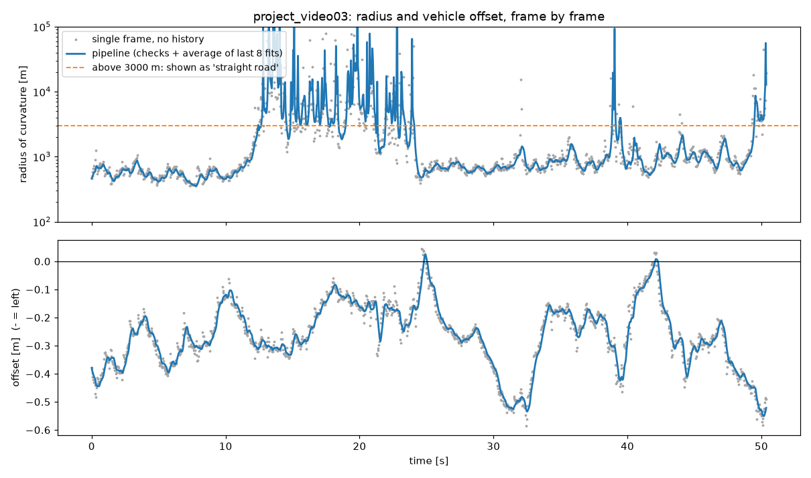

All processed videos are listed in [Results](#results).

---

## Limitations and possible improvements

**Problems that were solved along the way**

* **Three cameras, one calibration.** Undistortion is only possible for the `main` camera. The other two got their own
  perspective points and scale values instead.
* **Shadows, tar seams and concrete borders** produced strong gradients. The top-hat condition keeps only narrow bright stripes.
* **Brown dirt detected as yellow paint** on the mountain road. A hue range now separates the two.
* **The `challenge02` camera.** With the `main` profile the lane was found in only 41 of its 484 frames. With its own
  perspective points (`c2`) it is found in 418.

**Where the pipeline still fails.** In challenge03 (40 % of the frames with a new valid fit), the typical problems are strong
tree shadows, curves so sharp (radius below 50 m) that the lines leave the bird's-eye area sideways, and an overexposed
road surface:

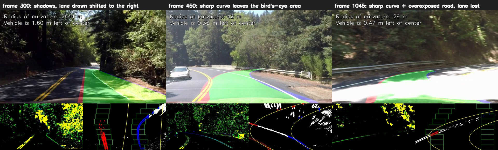

Other known limitations:

* The perspective transform assumes a **flat road**. On a hill, or when the car pitches, the lines in the bird's-eye view
  stop being parallel and a false curvature appears.
* The vehicle offset assumes the camera is in the **middle of the car**. All 17 test images show the car 6-43 cm left of
  centre, which suggests either a slightly off-centre camera or a driver who keeps left.
* **Lane changes.** Only the own lane is tracked. While the car crosses a line, there is no clear left and right line.
* **Night, rain and snow** are not part of the data and were not tested.

**Possible improvements**

* A shorter or adaptive bird's-eye area for sharp curves, so the lines stay inside it.
* A Kalman filter on the polynomial coefficients instead of a plain average, which reacts faster to real changes.
* Reusing the lane width from previous frames when only one line is visible.
* Adaptive contrast (e.g. CLAHE) against overexposed or very dark frames.
* A learned segmentation model for the lane mask, keeping the same geometry steps afterwards.

## References and acknowledgements

* Course **DOSiVuAV** (Digital Image and Video Processing in Autonomous Vehicles), FTN Novi Sad. The approach follows
  lecture 10 (binary image, histogram, sliding windows, polynomial), and the calibration follows lecture 9.
* Lecture code examples: [chedadsp/dosiv-py](https://github.com/chedadsp/dosiv-py) (`09_01_calibration.py`,
  `09_02_undistort.py`, `03_03_sobel.py`, `06_01_color_masking.py`).
* OpenCV documentation: [camera calibration](https://docs.opencv.org/4.x/dc/dbb/tutorial_py_calibration.html),
  [geometric transformations](https://docs.opencv.org/4.x/da/d6e/tutorial_py_geometric_transformations.html).
* The test images, videos and `writeup_template.md` are course material, originally from the lane-finding projects of
  Udacity's Self-Driving Car Engineer Nanodegree.
